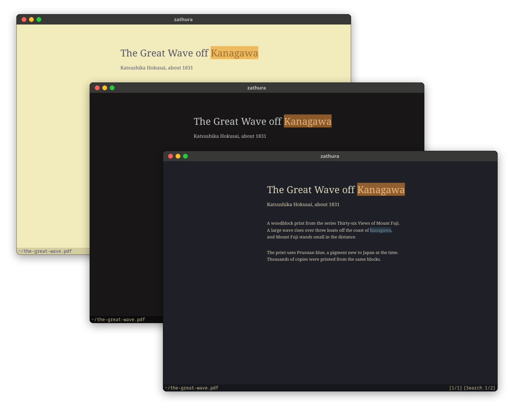
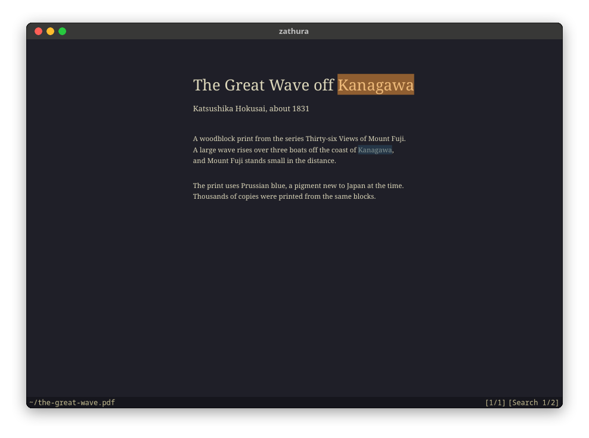
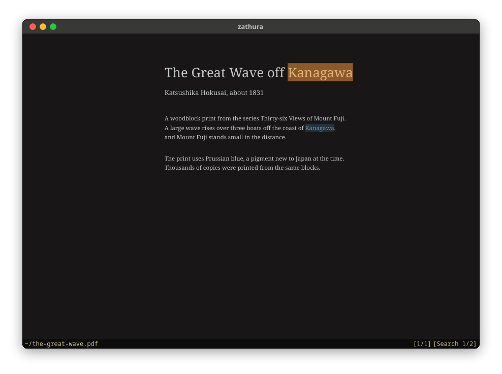
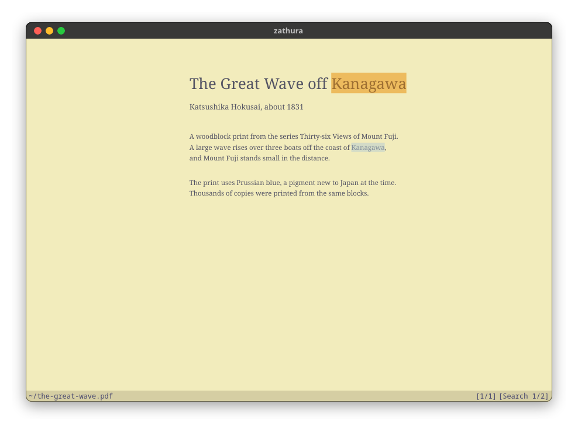

<h3>Kanagawa for <a href="https://pwmt.org/projects/zathura/">zathura</a></h3>
<p>A community-maintained theme inspired by Hokusai's <em>The Great Wave off Kanagawa</em>.</p>
<p>Using the <a href="https://github.com/rebelot/kanagawa.nvim">Kanagawa palette</a> by <a href="https://github.com/rebelot">Tommaso Laurenzi (rebelot)</a>.</p>

<!-- Wave accents: carpYellow, crystalBlue, autumnRed. Lotus accents: lotusYellow, lotusBlue4, lotusRed. -->
<p>
  <a href="https://github.com/kanagawa-community/zathura/stargazers">
    <picture>
      <source media="(prefers-color-scheme: dark)" srcset="https://img.shields.io/github/stars/kanagawa-community/zathura?style=for-the-badge&amp;labelColor=1F1F28&amp;color=E6C384">
      <source media="(prefers-color-scheme: light)" srcset="https://img.shields.io/github/stars/kanagawa-community/zathura?style=for-the-badge&amp;labelColor=F2ECBC&amp;color=77713F">
      
    </picture>
  </a>
  <a href="https://github.com/kanagawa-community/zathura/releases/latest">
    <picture>
      <source media="(prefers-color-scheme: dark)" srcset="https://img.shields.io/github/v/release/kanagawa-community/zathura?style=for-the-badge&amp;label=release&amp;labelColor=1F1F28&amp;color=7E9CD8">
      <source media="(prefers-color-scheme: light)" srcset="https://img.shields.io/github/v/release/kanagawa-community/zathura?style=for-the-badge&amp;label=release&amp;labelColor=F2ECBC&amp;color=4D699B">
      
    </picture>
  </a>
  <a href="https://github.com/kanagawa-community/zathura/issues">
    <picture>
      <source media="(prefers-color-scheme: dark)" srcset="https://img.shields.io/github/issues/kanagawa-community/zathura?style=for-the-badge&amp;labelColor=1F1F28&amp;color=C34043">
      <source media="(prefers-color-scheme: light)" srcset="https://img.shields.io/github/issues/kanagawa-community/zathura?style=for-the-badge&amp;labelColor=F2ECBC&amp;color=C84053">
      
    </picture>
  </a>
</p>

<br clear="both">
<br>

## Previews



<details>
<summary>🌊 Wave</summary>

</details>

<details>
<summary>🐉 Dragon</summary>

</details>

<details>
<summary>🪷 Lotus</summary>

</details>

## Requirements

- zathura 0.4.4 or later, which reads `include` in `zathurarc`.

## Installation

Download the three themes into ~/.config/zathura:

```sh
mkdir -p ~/.config/zathura
for variant in wave dragon lotus; do
  curl -fsSL -o ~/.config/zathura/kanagawa-$variant https://raw.githubusercontent.com/kanagawa-community/zathura/main/themes/kanagawa-$variant
done
```

Or clone the repository and run `./install.sh`. It installs all three variants,
or only the ones you name, for example `./install.sh dragon lotus`. `./uninstall.sh`
takes the same names and removes them.

## Usage

Include a theme in `~/.config/zathura/zathurarc`:

```conf
include kanagawa-wave
```

To draw the pages in the theme's colors too, add `set recolor true`.

## Palette

Every color comes from the shared
[palette](https://github.com/kanagawa-community/.github/blob/main/docs/PALETTE.md),
picked by role, so each variant uses its own value for the same role.

| zathura color                                                                   | Palette role                   |
| ------------------------------------------------------------------------------- | ------------------------------ |
| `default-*`, `index-*`, `render-loading-bg`, `recolor-lightcolor`               | `ui.bg`                        |
| `default-fg`, `index-fg`, `inputbar-fg`, `notification-fg`, `recolor-darkcolor` | `ui.fg`                        |
| `statusbar-bg`, `inputbar-bg`, `notification-bg`                                | `ui.bg_m3`                     |
| `statusbar-fg`, `completion-group-fg`, `render-loading-fg`                      | `ui.fg_dim`                    |
| `completion-*`                                                                  | `ui.pmenu.*`, `ui.bg_p1`       |
| `index-active-bg`                                                               | `ui.bg_visual`                 |
| `notification-error-bg`, `notification-error-fg`                                | `diag.error`, `ui.bg`          |
| `notification-warning-bg`, `notification-warning-fg`                            | `diag.warning`, `term.black`   |
| `highlight-color`, `highlight-active-color` (50% opacity)                       | `ui.bg_search`, `diag.warning` |

## Credits

This port replaces the zathura theme in the `extras` folder of the
[Neovim plugin](https://github.com/kanagawa-community/neovim). Dinesh Kumar first contributed that theme to kanagawa.nvim. The
colors come from [kanagawa.nvim](https://github.com/rebelot/kanagawa.nvim) by
Tommaso Laurenzi.

## Issues and contributions

Report bugs and request changes in this port's
[issue tracker](https://github.com/kanagawa-community/zathura/issues). Contributions are welcome.

See [CONTRIBUTING.md](CONTRIBUTING.md) before opening a pull request.

## License

MIT. See [LICENSE](LICENSE).
